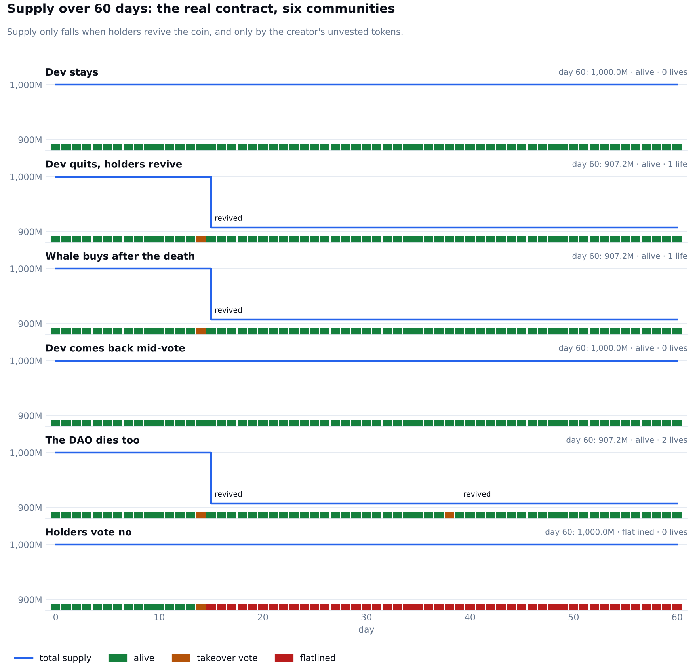

# Revive

**Onchain CTO for NEAR memecoins.**

Revive is a NEAR memecoin with a community takeover built into the contract.
The keeper has to send an on-chain **pulse** before every deadline. If the pulse
stops, the coin **flatlines**. Holders who held *before* the flatline can then
vote a Sputnik DAO in as the new keeper. If the vote passes, the creator's
locked tokens are **burned**, the treasury and the coin's links pass to the
DAO, and the coin gains a **life**. Every death and revival is written to
on-chain lore.

> Built at NEAR HACKATHON (November 2026).
> Tracks: **Memecoins With Mechanics** (primary), **Social Money** (Sputnik DAO as the steward).

**Live on NEAR testnet:** [mhiah.github.io/Revive](https://mhiah.github.io/Revive/) reads the factory
[`revive-ztw7t.revive.testnet`](https://testnet.nearblocks.io/address/revive-ztw7t.revive.testnet) and its coins over RPC:

* [`nine.revive-ztw7t.revive.testnet`](https://testnet.nearblocks.io/address/nine.revive-ztw7t.revive.testnet): flatlined, a whale's post-death vote refused, revived; 100M creator tokens burned.
* [`back.revive-ztw7t.revive.testnet`](https://testnet.nearblocks.io/address/back.revive-ztw7t.revive.testnet): the dev came back mid-vote and paid the penalty.

Connecting a token launched elsewhere runs through a second locked factory,
[`revive-bhtat.revive.testnet`](https://testnet.nearblocks.io/address/revive-bhtat.revive.testnet):

* [`meme-cia7y.revive-bhtat.revive.testnet`](https://testnet.nearblocks.io/address/meme-cia7y.revive-bhtat.revive.testnet) guards the plain NEP-141 [`meme-cia7y.revive.testnet`](https://testnet.nearblocks.io/address/meme-cia7y.revive.testnet): the dev locked 100M, holders staked, the dev went silent, a whale's post-death stake got no vote, holders took over and the dev's 100M is sealed in the guard. (`meme.revive-bhtat.revive.testnet` is from a run that stopped halfway; its demo accounts' keys were discarded, so it stays flatlined.)

**A coin that stays alive:** [`here.revive-6tx39.revive.testnet`](https://testnet.nearblocks.io/address/here.revive-6tx39.revive.testnet)
($HERE, "Still Here") has a 3-day heartbeat. The [keep-alive workflow](.github/workflows/keep-alive.yml)
pulses it twice a day, so Flatline Watch always shows a healthy coin next to the revived ones. It comes from
the current factory, [`revive-6tx39.revive.testnet`](https://testnet.nearblocks.io/address/revive-6tx39.revive.testnet)
(locked, no keys), which holds the fixed coin and guard code; the site's Launch and Connect use it. The coins
below were made by earlier locked factories and keep the version from before the two quorum fixes described
under [Tests](#tests). Their stories still show the full mechanic.

A takeover by a **real Sputnik DAO**, live on testnet:

* [`civic-vft8z.revive-ztw7t.revive.testnet`](https://testnet.nearblocks.io/address/civic-vft8z.revive-ztw7t.revive.testnet) ($CIVIC) accepts only Sputnik DAOs. Its dev went silent, holders voted in the Sputnik DAO [`civic-vft8z.sputnikv2.testnet`](https://testnet.nearblocks.io/address/civic-vft8z.sputnikv2.testnet) (council: two holders), and the DAO now runs the coin by proposal: it brought $CIVIC back by paying the comeback penalty into the treasury, then paid a contributor 0.05 NEAR from the treasury. A council member acting alone can't spend.

The other testnet coins nominate stand-in steward accounts to save test NEAR (a Sputnik DAO costs about 5.6 NEAR to create);
the **Verify** tab labels them as stand-ins.

All stories were played by the [testnet-demo workflow](.github/workflows/testnet-demo.yml) with 60-second timers,
so both coins have since flatlined again: anyone holding from before can open a takeover.

**Already launched somewhere else?** Any NEP-141 token can be **connected**: Revive deploys a guard next to it
with the same heartbeat and takeover rules ([below](#connect-a-coin-launched-elsewhere)).

**No wallet?** [mhiah.github.io/Revive/?demo](https://mhiah.github.io/Revive/?demo) runs a simulator with the same rules.
Open **Nine Lives** and click the story buttons in order.

## Judge quickstart

| Do this | You should see |
| --- | --- |
| Open [mhiah.github.io/Revive](https://mhiah.github.io/Revive/) | **Flatline Watch** listing `$NINE`, `$BACK` and the connected `$MEME` (tagged *connected*), read live from NEAR testnet |
| Click **Nine Lives** → **Verify** | Six checks from RPC: no access keys on the coin, its code hash equals the factory's, the factory has no keys, treasury backed, supply adds up (100M burned), and who the keeper is |
| Click **Lore** | The coin's on-chain history: born, flatline, takeover, revived |
| Click **Activity** | Token transfers over time, every pulse and vote marked, flatlined stretches shaded red |
| In the simulator, open **Meme Cooked** (tagged *connected*) | A token launched elsewhere: stake, skip time, let the whale buy and stake after the death (no vote), take it over, then **Verify** shows the guard holds every staked and sealed token |
| Open [mhiah.github.io/Revive/?demo](https://mhiah.github.io/Revive/?demo) → **Nine Lives**, click steps 1–11 | The full story with no wallet: a whale's post-death vote is refused, the coin revives, the DAO pulses |
| `cd contract && cargo test` | `76 passed` (plus `guard`: `35 passed`, `factory`: `24 passed`): [what each group proves](#tests) |
| `cd contract && cargo run --example simulate` | The [60-day simulation](#60-day-simulation): six scenarios' day-60 results printed; `docs/simulation.json` rewritten |
| Latest [CI run](https://github.com/Mhiah/Revive/actions/workflows/contract.yml) → **sandbox-e2e** | All four stories on a local NEAR node, including connecting an outside token and a takeover by a real Sputnik DAO, every step checked (`All checks passed`) |
| [testnet-demo run](https://github.com/Mhiah/Revive/actions/workflows/testnet-demo.yml) | The same stories on NEAR testnet, against the coins above |

## Why

When a memecoin's dev walks away, holders often run a *community takeover*
(CTO): they open a new Telegram, a new X account and carry on. It is one of the
best-known rituals in memecoin culture
([crypto.news](https://crypto.news/what-is-a-community-takeover-cto-when-a-memecoins-holders-seize-the-wheel/)),
and some coins, such as Billy, survived being abandoned this way
([Decrypt](https://decrypt.co/241846/how-solana-meme-coin-billy-survived-being-abandoned-by-its-dev)).

But today a CTO happens entirely off-chain. The contract, the dev's tokens and
any treasury stay where they were, so the takeover can be "mostly cosmetic"
([DEXTools](https://www.dextools.io/tutorials/what-is-a-cto-in-crypto-guide-2026)).
Revive turns the CTO into contract rules.

## The mechanic

| Step | What happens | Where |
| --- | --- | --- |
| **Pulse** | The keeper calls `pulse` before `last_pulse + pulse_interval`. Free when on time. | `pulse` |
| **Flatline** | No pulse by the deadline: status becomes `flatlined`. The keeper can no longer spend the treasury, claim vested tokens or change links. | `status`, `assert_alive` |
| **Takeover** | Any holder with weight nominates a Sputnik DAO (`*.sputnikv2.testnet` / `*.sputnik-dao.near`) as steward. A vote opens. | `start_takeover` |
| **Vote** | Weight = token-seconds held **before the flatline**. Keeper and creator cannot vote. | `vote`, `weight_at` |
| **Comeback** | During the vote the old keeper can still pulse, but must pay `comeback_penalty` into the treasury. The vote is cancelled. Once the vote closes, comebacks are blocked. | `pulse` |
| **Revival** | Yes > No and Yes ≥ quorum: the DAO becomes keeper, the creator's unvested tokens are burned, `lives += 1`. | `finalize_takeover` |
| **Lives** | A DAO keeper can flatline too. The cycle repeats, and the coin keeps counting lives. | `lives`, `get_lore` |

Creator tokens (at most 10% of supply) are locked in the contract and vest only
while the creator is alive and still keeper. The keeper can spend treasury NEAR
only within a per-period cap, and every spend is written to the lore.

### Why buying votes after the death doesn't work

Each holder stores `since`: the balance-weighted average time their tokens
arrived. Vote weight is `balance × (flatline_at − since)`.

* A wallet that buys after the flatline has `since > flatline_at`, so its weight is **0**.
* Moving tokens into an older wallet after the flatline pulls that wallet's `since` forward. The new tokens *subtract* weight instead of adding it.
* Voting and then sending your tokens to a second wallet gives the second wallet nothing.
* Averages round **up**, so rounding never makes tokens look older.
* Refunds from `ft_transfer_call` (for example a DEX returning unused tokens) restore the sender's own `since`, so using a DEX costs no hold time.

This matters: in 2026 an attacker drained roughly $20M from BonkDAO after
buying just over 1% of supply to pass a malicious proposal
([Crypto Daily](https://cryptodaily.co.uk/2026/07/are-memecoins-dead-liquidity)).

The quorum compares Yes weight with **all** eligible weight. The contract keeps
a running `Σ balance × since`, so the total is one multiplication, whether the
coin has 10 holders or 10 million.

## Connect a coin launched elsewhere

Most memecoins already exist: on meme.cooking, another launchpad, or a contract
someone wrote. Revive doesn't ask anyone to migrate. **Connect a coin** gives an
existing NEP-141 token the same CTO rules without touching the token:

| Step | What happens | Where |
| --- | --- | --- |
| **Connect** | Anyone holding the token calls the factory with its account. The factory reads `ft_metadata` (name, symbol, decimals), deploys a **guard** at `<name>.<factory>` with no keys, and registers the guard on the token. The caller becomes creator and first keeper. | `factory.connect` |
| **Lock the bag** | The creator sends tokens to the guard with `ft_transfer_call(msg: "lock")`. They vest only while the creator keeps pulsing. | `ft_on_transfer` |
| **Stake** | Holders send tokens with `msg: "stake"`. Stake carries the same `since` clock as a Revive coin, so weight is stake × time staked before the flatline. `unstake` returns tokens at any time. | `ft_on_transfer`, `unstake` |
| **Pulse, flatline, takeover, comeback** | Same rules and the same lore as a Revive coin. | `pulse`, `start_takeover`, `vote`, `finalize_takeover` |
| **Revival** | The DAO becomes keeper. The token can't be burned by someone else's contract, so the creator's unvested bag is **sealed** in the guard forever: it can never be claimed or moved. | `finalize_takeover` |

Anything other than `lock` or `stake` is refused and refunded by the token. A
failed `unstake` or `claim_vested` transfer is rolled back with the holder's
original `since`. **Verify** reads the token's own `ft_balance_of(guard)` and
checks it covers staked + locked + sealed.

## 60-day simulation

The track's example prompt asks to "simulate 60 days of community behavior first and show supply
over time under a few scenarios." [`contract/examples/simulate.rs`](contract/examples/simulate.rs) does that
with the **real contract**, not a model: every pulse, buy, vote and takeover is a call into `Revive`
under a mocked NEAR runtime with a moving clock. 12 holders, daily buys and tips, a keeper who pulses
every other day until they don't. Parameters: 1B supply, 10% creator allocation vesting over 90 days,
3-day pulse, 1-day vote, 20% quorum, 2 NEAR comeback penalty.



| Scenario | Day 60 | Lives | Supply | Creator tokens burned | Treasury |
| --- | --- | --- | --- | --- | --- |
| Dev stays | alive | 0 | 1,000M | 0 | 12.0 NEAR |
| Dev quits on day 12, holders revive | alive | 1 | 907.2M | 92.8M | 12.5 NEAR |
| Whale buys 300M after the death | alive (whale's vote refused) | 1 | 907.2M | 92.8M | 12.5 NEAR |
| Dev comes back mid-vote | alive | 0 | 1,000M | 0 | 18.5 NEAR (+2 penalty) |
| The steward DAO dies too | alive | 2 | 907.2M | 92.8M | 13.0 NEAR |
| Holders vote no | flatlined | 0 | 1,000M | 0 | 16.5 NEAR |

What it shows: supply only ever falls, and only by the creator's *unvested* tokens on the first revival
(the 7.2M the dev vested while alive stay theirs). A whale arriving after the death changes nothing. A comeback is
possible but costs the dev, and the penalty stays with holders. Each extra life costs nothing to supply.
Full day-by-day data: [docs/simulation.json](docs/simulation.json).

### Picking the parameters

The same run then sweeps the two settings that matter most, again on the real contract
(`sweeps` in [docs/simulation.json](docs/simulation.json)).

**Quorum.** Each row is a revival vote where only some holders turn up. "Yes" is their share of the
eligible (pre-death, hold-time weighted) total.

| Who votes yes | Their weight | 10% quorum | 20% quorum | 35% quorum |
| --- | --- | --- | --- | --- |
| The 2 smallest holders | 0.9% | fails | fails | fails |
| 3 mid-size holders (a quarter of holders) | 8.2% | fails | fails | fails |
| Half of holders | 17.6% | **passes** | fails | fails |

**Heartbeat.** A keeper who remembers to pulse on half of all days, over 60 days, 20 runs each.

| Pulse every | Accidental deaths | Days spent dead by accident | Holders wait after a real quit |
| --- | --- | --- | --- |
| 1 day | 15.4 | 31.4 | 1 day |
| 3 days | 4.2 | 8.6 | 3 days |
| 7 days | 0.4 | 0.6 | 7 days |

What we picked:

* **Quorum 10% for most coins.** A handful of small or mid-size wallets can't take a coin over, but
  half of the real holders can. At 20% even half of holders fail, because tokens in pools and in
  wallets that never vote still count in the total. Raise it only for coins with few, active holders.
* **7-day pulse for a keeper who pulses by hand**: under one accidental death in 60 days, and holders
  wait a week at most. **3 days when a bot pulses**, like [$HERE](#revive), which pulses twice a day
  from a scheduled workflow, so missed days aren't a risk and holders wait less.
* **1-day vote, 2 NEAR comeback penalty** stay as in the scenarios: long enough to vote, and a
  comeback costs the dev something that stays with holders.

Both are fixed at launch; nobody can change them later. The scenarios above use 20% so the attack
cases are tested against a stricter bar.

## The app

| Page | What it shows |
| --- | --- |
| **Flatline Watch** | A table of every coin and connected token: its pulse status, its shelf life (time left before it flatlines, with a bar), and a trend arrow (▲ healthy, ▼ fading, dead or in a vote). Open takeovers come first, then dead coins, then whoever is closest to death. |
| **Launch** | A form that calls the factory: name, supply, locked share, pulse interval, vote length, quorum, penalty, treasury seed. |
| **Connect a coin** | Paste a token account: the app checks it answers `ft_metadata`, shows its supply and your balance, and connects it. The coin page then has **Lock your bag** for the creator and **Stake / Unstake** for holders. |
| **Coin · Monitor** | A live heart monitor (green alive, red flatlined, amber voting), countdown, lives, treasury, the takeover vote and the keeper. |
| **Coin · Activity** | One time axis: token transfers per bucket, every pulse, vote, takeover and revival marked above, and every stretch without a pulse shaded as flatlined. Hover for a bucket's details; a table view is one click away. |
| **Coin · Verify** | Checks read live from NEAR RPC: no access keys on the coin, same code hash as the factory (with the hex to compare against CI), factory locked, treasury backed, supply adds up (for a connected coin: the token says the guard holds everything it owes), keeper is a DAO. |
| **Coin · Lore** | Every birth, death, takeover, comeback and revival, from the contract. |

State is read directly over RPC; there is no backend. The **Activity** chart also needs past
transactions, which RPC nodes don't keep, so it reads them from FastNEAR's public transactions API
and counts the token's own NEP-141 `ft_transfer` events. If that API is unavailable, the chart falls
back to the contract's lore and current deadline and says so.

## How we used NEAR

| NEAR feature | Use in Revive |
| --- | --- |
| NEP-141 / 145 / 148 / 297 | Full fungible token with storage registration, metadata and events (`nep141` plus a `revive` event standard). |
| Factory sub-accounts | `revive.<you>` launches every coin as `<name>.revive.<you>` with the same stored code. Coin accounts are created with no keys. |
| Sputnik DAO | A revived coin's keeper is a Sputnik DAO. The DAO pulses, spends and updates links through FunctionCall proposals ([scripts/dao-pulse.md](scripts/dao-pulse.md)). |
| Named accounts | Stewards are checked by account suffix: only accounts created by the Sputnik factory can be nominated. |
| Access keys | Coins never get a key; the factory's key is deleted after the code is stored, so nobody can change how coins are made. |
| `ft_transfer_call` | Works with Rhea pools and other receivers; refunds keep hold time. |

## Run it

### Tests

**135 unit tests, no network needed.** One command per contract:

```bash
(cd contract && cargo test)   # 76 tests, ~50 s (the random histories take most of it)
(cd guard && cargo test)      # 35 tests
(cd factory && cargo test)    # 24 tests
```

Each group proves one kind of claim:

| Group | File | Tests | What it proves |
| --- | --- | --- | --- |
| Lifecycle | [contract/src/tests.rs](contract/src/tests.rs) | 21 | Launch, pulse, flatline, takeover, revival, comeback, two deaths and two revivals, DEX refunds keep hold time, only the factory names a creator |
| Attacks | [contract/src/tests/attacks.rs](contract/src/tests/attacks.rs) | 19 | Buying after the death neither votes nor moves the quorum; splitting or hopping wallets adds no weight; no double votes; the creator can't vote, start a takeover or move locked tokens; lookalike DAO names are refused |
| Timing | [contract/src/tests/timing.rs](contract/src/tests/timing.rs) | 12 | The exact second each deadline flips: pulse due, vote closing, finalizing, a last-second comeback; ties fail; takeovers back to back; a revival restarts the clock |
| Money | [contract/src/tests/money.rs](contract/src/tests/money.rs) | 21 | Spending exactly the cap, one yocto over, the reset; vesting is linear and never overpays; a revival burns only what wasn't claimed; supply always adds up |
| Random histories | [contract/src/tests/invariants.rs](contract/src/tests/invariants.rs) | 3 | About 7,000 seeded random steps (transfers, pulses, comebacks, claims, spends, takeovers, votes). After every step: balances add up to supply, the quorum total equals a holder-by-holder sum, no weight beats its ceiling, the treasury matches every deposit and spend |
| Connected coins | [guard/src/tests.rs](guard/src/tests.rs) and [guard/src/tests/](guard/src/tests) | 35 | Lock and stake only through the real token; late stake buys no vote and doesn't move the quorum; a DAO that staked before its election doesn't inflate the next quorum; failed unstakes and claims roll back; random histories where the guard always holds exactly what it owes |
| Factory | [factory/src/lib.rs](factory/src/lib.rs) and [factory/src/tests_more.rs](factory/src/tests_more.rs) | 24 | Code stored once and never changed; failed launches and connects are refunded and not listed; names and deposits are checked; the registry pages correctly |

**Two bugs these tests found, both fixed:** the quorum's yardstick (the total weight from before the death)
used a running sum that subtracted weight for tokens moved after the death. Heavy trading after a death
could push it to zero, so any single "yes" met the quorum. In the guard, a DAO that had staked before it
was elected kept its stake in that yardstick after winning, though it can't vote. The regression tests
are `eligible_total_ignores_tokens_bought_after_the_death`,
`late_stake_does_not_shrink_the_eligible_total` and
`a_dao_that_staked_before_its_election_does_not_inflate_the_next_quorum`.

**End-to-end on a real NEAR node:** CI starts a local NEAR sandbox and runs
[scripts/demo-coins.mjs](scripts/demo-coins.mjs): it deploys the factory, stores
the code, deletes the factory's key, launches three coins, connects an outside
token and plays four stories with real wasm and a real clock, checking every step:

* **$NINE**: the dev goes silent, a whale buys 250M after the death and is refused a vote, holders vote a steward in, the coin revives, 100M creator tokens burn, the old dev can no longer pulse, the steward pulses.
* **$BACK**: the dev goes silent, a takeover opens, a late pulse without the penalty is refused, the dev pays the 0.2 NEAR penalty, the vote is cancelled and the penalty lands in the treasury.
* **$MEME**: a plain NEP-141 ([samples/plain-token](samples/plain-token), no Revive code) is connected. The factory reads its name from the token and registers the guard. The dev locks 100M, holders stake 600M, the dev goes silent, a whale stakes 250M after the death and gets weight 0, holders take over, the 100M bag is sealed, the token confirms the guard holds exactly staked + sealed, and a holder unstakes back to their wallet.
* **$CIVIC**: the takeover goes to a **real Sputnik DAO**, running the exact contract code testnet DAOs run (fetched from testnet). $CIVIC accepts only Sputnik DAOs. After the revival the old dev can't pulse; the DAO pulses $CIVIC through a proposal its council approves, then pays a contributor 0.05 NEAR from the coin's treasury the same way. A council member acting alone can't spend.

```bash
cd scripts && npm install && cd ..
node scripts/sandbox-e2e.mjs      # needs the two wasm files from CI or cargo near build
```

**The same stories on testnet:** run the **testnet-demo** workflow (Actions tab)
after adding `NEAR_ACCOUNT_ID` and `NEAR_PRIVATE_KEY` secrets for a funded
testnet account. Pick the stories with `stories` (`coins`, `guard`, or both); the run prints
how much NEAR it needs before it starts. It uploads `demo-coins.json` with the factory
and coin names. Pass an existing Sputnik DAO as `steward` to nominate a real DAO.

**The app:** open `web/index.html` (demo mode), or `?factory=revive-xxxxx.you.testnet`
for live testnet data. Wallet signing uses [NEAR Connect](https://github.com/hot-dao/near-connect).
The site is published to GitHub Pages on every push.

## Contract API

| Method | Who | Notes |
| --- | --- | --- |
| `new(config)` | creator | Launch. Attached NEAR seeds the treasury. |
| `pulse()` | keeper | Late = comeback, needs `comeback_penalty`. |
| `claim_vested()` | creator | Only while alive and still keeper. |
| `fund_treasury()` | anyone | Payable. |
| `spend(receiver_id, amount, memo)` | keeper | Within `spend_cap` per `spend_period_secs`. |
| `set_links(icon, links)` | keeper | |
| `start_takeover(steward)` | holder with weight | After the flatline. |
| `vote(support)` | holder with weight | One ballot per takeover. |
| `finalize_takeover()` | anyone | After the vote ends. |
| `get_status`, `get_vote_weight`, `get_ballot`, `get_lore`, `get_lore_count` | view | |
| NEP-141 / NEP-145 methods | | `ft_balance_of(<contract>)` returns the creator's locked tokens. |

**Factory**

| Method | Who | Notes |
| --- | --- | --- |
| `new(owner)` | deployer | |
| `store_code()` | owner, once | The coin wasm as raw input. Can never change afterwards. |
| `launch(name, config)` | anyone | Attach ≥ `get_launch_cost()` (the coin's code size plus room for state, about 2.5 NEAR), with 300 TGas. Creates `<name>.<factory>`; the caller becomes creator and keeper; extra NEAR seeds the treasury. Refunds if the launch fails. |
| `store_guard_code()` | owner, once | The guard wasm as raw input. |
| `connect(name, config)` | anyone | Attach ≥ `get_connect_cost()` (about 2.2 NEAR), with 300 TGas. `config.token_id` is the NEP-141 to guard. Reads its metadata, creates `<name>.<factory>` with no keys, registers it on the token, records it with `kind: "guard"`. Refunds if the token check or the deploy fails. |
| `get_coins`, `get_coin_count`, `get_code_hash`, `get_guard_code_hash`, `get_launch_cost`, `get_connect_cost`, `get_owner` | view | |

**Guard** (a connected coin)

| Method | Who | Notes |
| --- | --- | --- |
| `ft_on_transfer` | the token | `msg: "lock"` from the living creator, or `msg: "stake"` from anyone else. Anything else is refunded. |
| `unstake(amount)` | staker | Attach 1 yoctoNEAR, 100 TGas. Rolled back if the token transfer fails. |
| `pulse`, `claim_vested`, `fund_treasury`, `spend`, `set_links`, `start_takeover`, `vote`, `finalize_takeover` | as above | Same rules as a Revive coin; on revival the creator's bag is sealed, not burned. |
| `get_status`, `get_stake`, `get_vote_weight`, `get_ballot`, `get_lore`, `get_lore_count` | view | `get_status` has `kind: "guard"`, `token_id`, `staked`, `stakers`. |

## Limits (honest list)

* **Off-chain assets don't move.** The contract can't take over the dev's X account, Telegram or website. Revive moves what lives on-chain: the keeper role, treasury, links, metadata icon and the dev's tokens. Takeover teams may also face IP questions about the original art ([Decrypt](https://decrypt.co/247781/meme-coin-takeover-teams-face-legal-entanglement-experts-say)).
* **Connected coins only count stake.** Tokens sitting in wallets or pools don't vote; holders have to stake, and the guard can't see who held before connecting. A sealed bag leaves circulation for good, but the token's `ft_total_supply` doesn't drop, because only the token can burn. And the guard can't stop powers the token itself grants, such as an owner who can still mint.
* **Hold-time is not identity.** A patient attacker can buy early and wait. Revive stops *buying a vote after the death*; it does not stop someone who planned ahead.
* **Pools count but never vote.** Tokens in a liquidity pool held before the death count toward the eligible total, but a pool can't vote. That's why we recommend a 10% quorum (see [Picking the parameters](#picking-the-parameters)).
* **Earlier testnet coins keep an older quorum count.** Coins from the first two factories (`revive-ztw7t`, `revive-bhtat`) count tokens bought after the death as slightly negative, which makes their quorum a little lenient. Our tests found it; coins from the current factory count exactly.
* **Demo stewards.** The quick demo stories use a stand-in steward account instead of a Sputnik DAO, because a DAO costs about 5.6 testnet NEAR. The [$CIVIC](#revive) story uses a real Sputnik DAO, and coins launched from the app require `.sputnikv2.testnet` / `.sputnik-dao.near`.
* **meme.cooking untested.** Connect works with any NEP-141 token and was tested on our own plain token; we haven't run it against a real meme.cooking token yet.
* **Storage.** Each coin carries its own copy of the code, so a launch costs about 2.5 NEAR of storage. NEAR global contracts would cut that; they were left out to keep testnet costs predictable.
* **Treasury transfers to accounts that don't exist** are refunded to the contract's balance, but not re-added to the `treasury` counter.
* **Unaudited.** Testnet only. The wasm is built in CI; the build is not yet reproducible (`cargo near build reproducible-wasm` is the next step).

## Repository layout

```
contract/            the coin (near-sdk 5.30)
  src/lib.rs         state, keeper, takeover, revival, views
  src/token.rs       NEP-141 / 145 / 148 and hold-time accounting
  src/tests.rs       21 unit tests
factory/             launches coins and connects tokens as <name>.<factory>; 10 unit tests
guard/               the guard for a connected token: lock, stake, takeover; 14 unit tests
samples/plain-token/ a plain NEP-141 standing in for a coin launched elsewhere
contract/examples/   simulate.rs: 60 days x 6 scenarios on the real contract
web/index.html       the app: Flatline Watch, Launch, Connect, coin Monitor / Activity / Verify / Lore, demo mode
docs/                simulation data and README images
scripts/             demo-coins.mjs (deploy + three stories), sandbox-e2e.mjs, Sputnik DAO how-to
.github/workflows/   CI (tests, lints, wasm, sandbox e2e), Pages, testnet-demo
```

## Hackathon notes

* All code was written during NEAR HACKATHON (1–14 November 2026); the first commit is from 8 November 2026.
* Libraries: near-sdk 5.30, near-api-js 7.4, near-sandbox 0.3, NEAR Connect 0.12 (loaded from esm.sh). No templates.

## License

MIT
